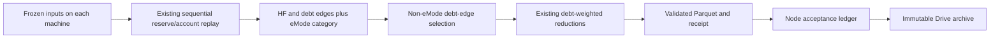
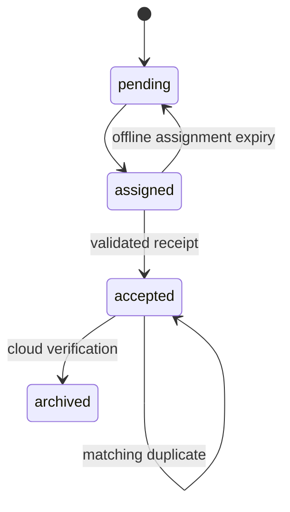

# Node-coordinated Aave HF cohort replay

## Goal Capsule
Deliver every-block reserve and protocol debt-weighted HF with eMode accounts excluded at the observation block, across the existing frozen Ethereum V3 scope. Node coordinates four machines and accepts results even when Data is offline. The user authorized implementation, deployment, measurement and manifest-scoped retirement of node copies whose Drive backup is verified. The goal owner completes deployment and archive acceptance.

## Product Contract
### Summary and Problem Frame
The existing aggregate series includes eMode borrowers. Final wallet vectors omit debt weights, while retained replay inputs reconstruct them. A separate cohort aggregate requires replay and fresh reductions. The user accepts a one-to-two-day calculation window and requests readable modular code suitable for eventual integration with event, reverted-transaction and state pipelines.

### Requirements
- R1. Cover blocks 16,291,127 through 26,407,881 with the original frozen finalized hash, reserve registry, historical math and USD0.01 analytical debt rule.
- R2. Include debt edges in filtered aggregates exactly when the wallet category at that block is zero. All reserves of an excluded wallet are excluded together. Retain aggregate numerator and denominator, included/excluded diagnostics and historical category provenance.
- R3. Reuse the wallet HF calculation and retained raw/factor inputs. Preserve the prior scientific generation and its Drive copy. No wallet numerical definition changes.
- R4. Node is sole authority for this run. Node, Revert, Compute and Data compute independently from local frozen inputs. Data outage cannot prevent eventual completion. Duplicate late results must be reconciled idempotently without duplicate accepted coverage.
- R5. Separate reusable numerical/filter/validation/storage contracts from host deployment and scheduling. Preserve the old deployed code and protected services while introducing the new run.
- R6. Retire only authorized old HF result archives on node after checking exact remote manifest identities, remote size/checksums and existing SHA readback proofs. Preserve reconstruction inputs, dictionaries, receipts, indices, code and recovery maps. Update availability metadata to describe cloud-only old result payloads.
- R7. Benchmark a representative real job and choose host concurrency from observed runtime and memory. Validate category transitions, debt attribution and own-node samples before full production.

### Assumptions
Exclude eMode per wallet-block, rather than excluding every wallet that ever entered eMode. The deliverable is new reserve/protocol series with separate identity. Existing wallet HF remains available in the prior release. Original inputs and version-aware math remain authoritative.

## Planning Contract
### Key Technical Decisions
- KTD1 (session-settled, user-directed). Node owns the new durable ledger and dispatch, replacing the prior temporary Compute coordination for this new run only.
- KTD2. Use BatchEvaluator and FloatBatch unchanged to obtain HF and debt edges. Apply a cohort mask before existing NumPy bincount aggregation. New acceptance checks independently verify membership as well as arithmetic.
- KTD3. Place new work under scripts/user-history/hf_market_replay with explicit modules for cohorts, calculation, validation and execution. Provide one documented CLI entry point. No wholesale relocation of pinned legacy modules.
- KTD4. Use bounded jobs and node-owned finite assignments. Expired offline assignments may be retried elsewhere. Match generation/job/content identities on acceptance and never count late duplicate coverage twice.
- KTD5. Use existing PyArrow storage, atomic artifact writers, manifest hashing, SQLite transaction/backup and rsync/rclone APIs. Custom work covers cohort science, job adaptation and node scheduling gaps.

### High-Level Technical Design
Directional data flow:

Directional task lifecycle:

Host-specific paths, unit limits and authentication are deployment configuration. All workers carry locally readable immutable inputs. Only accepted node receipts advance coverage. Metadata and append-only research evidence live alongside the new run.

## Implementation Units
### U1. Cohort calculation and verification
Requirements R1, R2, R3, R5, R7. Files under scripts/user-history/hf_market_replay for cohorts, calculation, validation and tests. Reuse FloatBatch outputs and aggregate. Emit filtered N/W/HF and diagnostics with explicit block/reserve/category semantics. Verify no-eMode equality, all-eMode null denominator, mixed multi-reserve debt, category entry/exit at block end, dust and exact boundary handling. Validate a real cohort and unchanged individual HF against own node. Existing HF engine tests remain applicable.

### U2. Node authority and four-host execution
Depends on U1. Requirements R4, R5, R7. Add runner/coordinator modules and deployment files under the same package. Reuse artifact/ledger interfaces where their existing scope fits. Finite assignments, per-job immutable outputs, bounded local buffers and idempotent accepted receipts support restarts and offline Data. Verify restart without replaying accepted jobs, Data unavailable reassignment and late duplicate rejection/reconciliation. Measure real canaries before selecting production slots.

### U3. Verified archive retirement and release
Depends on verified U1 inputs, can proceed alongside U2 rollout. Requirements R3, R6. Add a manifest-scoped retirement invocation using existing archive proofs and retirement helpers. Preserve metadata and cloud restore paths. Verify a restore/readback from old Drive archives before retirement. Produce exact retirement receipts and update the old release location evidence. Archive new results through existing copy/check/readback APIs and publish dataset definitions and provenance.

## Verification Contract
Unit tests exercise cohort membership, reduction arithmetic, replay boundary and acceptance identities. Run meaningful existing numerical and artifact tests affected by reuse. A Linux frozen-runtime canary must compare stored output with independently selected cohort reductions and own-node user HF/category/debt samples, recording actual RPC. A small four-host pilot must demonstrate node acceptance, restart and Data outage behavior. Verify complete disjoint block/reserve coverage from SQLite receipts. Cloud acceptance requires exact manifest/object checks and SHA readbacks before any authorized result retirement.

## Definition of Done
The modular implementation is readable and tested through its normal CLI, all available machines have run real accepted work, Data outage recovery is proven, all historical cohort aggregate jobs are accepted and archived, and dataset metadata documents the filter and units. Authorized old-node retirement has exact Drive proofs and recovery mappings. Preserve original inputs and protected services. Remove abandoned new-run code before completion. Runtime progress belongs in receipts and logs, not this plan.

## Sources
- scripts/user-history/native_batch.py
- scripts/user-history/hf_batch_f64.py
- scripts/user-history/hf_aggregates.py
- scripts/user-history/hf_flow_worker.py and hf_flow_queue.py
- docs/data-collection/aave-v3/DATASET-RETENTION.md
- /tmp/hf-emode-reuse-research.md
- https://numpy.org/doc/stable/reference/generated/numpy.bincount.html
- https://docs.python.org/3/library/sqlite3.html#sqlite3.Connection.backup
- https://rclone.org/commands/rclone_check/
